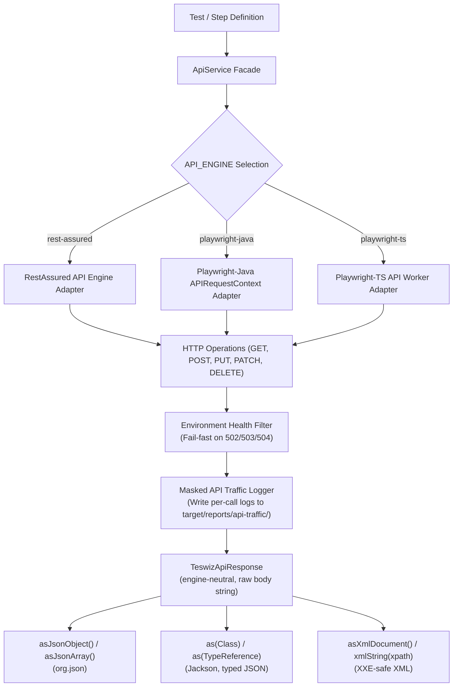

# API Test Execution
[📚 Documentation Index](../index.md) • [🏠 Main README](../../README.md)

---


## Table of Contents

- [Command:](#command)
- [Supported API Engines (`API_ENGINE`)](#supported-api-engines-api_engine)
- [API Config.properties File Params:](#api-configproperties-file-params)
- [Sample API scenario Example:](#sample-api-scenario-example)
- [Sample API Workflow scenario Example:](#sample-api-workflow-scenario-example)
- [Reportportal Execution report:](#reportportal-execution-report)
- [Migration Guide: Moving from RestAssured to Playwright Java (`API_ENGINE`)](#migration-guide-moving-from-restassured-to-playwright-java-api_engine)
  - [1. Suites using `ApiService` Facade (Recommended)](#1-suites-using-apiservice-facade-recommended)
  - [2. Suites using Direct `RestAssured` Calls](#2-suites-using-direct-restassured-calls)

---


## 💻 Command:

```bash
CONFIG=./configs/<apiConfig.properties> TAG=<ScenarioTag> PLATFORM=api ./gradlew run
```

To run with a specific API engine:

```bash
API_ENGINE=rest-assured CONFIG=./configs/api_local_config.properties TAG=@api PLATFORM=api ./gradlew run
API_ENGINE=playwright-java CONFIG=./configs/api_local_config.properties TAG=@api PLATFORM=api ./gradlew run
API_ENGINE=playwright-ts CONFIG=./configs/api_local_config.properties TAG=@api PLATFORM=api ./gradlew run
```

## 🔌 Supported API Engines (`API_ENGINE`)

teswiz supports three API engines through the unified `ApiService` facade:

- **`rest-assured`** (default): RestAssured HTTP client execution.
- **`playwright-java`**: Playwright Java native `APIRequestContext` HTTP execution.
- **`playwright-ts`**: Playwright TypeScript worker protocol HTTP execution.



All engines support full payload serialization and data type parity:
- Data payloads: `Map<String, Object>`, `Collection`/`List`, `JSONObject`, `JSONArray`, `String`, numbers, booleans, and byte arrays.
- HTTP operations: `GET`, `POST`, `PUT`, `PATCH`, `DELETE`.
- Transient Retry Handling: Automatic retries (configurable via `API_MAX_RETRIES`, resolved from an environment variable or `-D` system property first, then `config.properties`, then the default of 3, and never below 1; progressive linear backoff) on network timeouts, connection drops, and gateway server errors (`502 Bad Gateway`, `503 Service Unavailable`, `504 Gateway Timeout`). Application-level status codes (e.g. 200, 400, 401, 404, 422, and 500 Internal Server Error) represent expected application responses or application bugs and return immediately without retry.
- Traffic logging: Automatic masked HTTP request/response logging under `api-traffic/`.

> **Calls that are not safe to resend** (for example POSTs that place a bet or void a transaction): set `API_MAX_RETRIES=1` in `config.properties` to fail fast on the first 502/503/504 or exception instead of retrying.

## Reading the response body

Every engine returns a `TeswizApiResponse`. The accessors below work off the raw body string, so they behave the same whichever engine produced the response.

| Accessor | Use it to |
| :--- | :--- |
| `asJsonObject()` / `asJsonArray()` | Read JSON with `org.json` |
| `as(Class<T>)` | Map the JSON body to your own type (Jackson) |
| `as(TypeReference<T>)` | Map the JSON body to a generic type such as `List<Foo>` |
| `asXmlDocument()` | Parse the body as an `org.w3c.dom.Document`. DOCTYPE and external entities are disabled because the body is untrusted |
| `xmlString(xpath)` | Evaluate an XPath against the XML body; returns the matched text, or an empty string when nothing matches |

```java
TeswizApiResponse response = ApiService.get(baseUrl, queryParams);

Forecast forecast = response.as(Forecast.class);
List<Forecast> forecasts = response.as(new TypeReference<List<Forecast>>() {});

String city = response.xmlString("/response/location/city");
```

A body that is not valid JSON or XML, or an invalid XPath, fails fast with an `InvalidTestDataException` that names the target type or XPath.

## API Config.properties File Params:

```properties
FRAMEWORK=cucumber
APP_NAME=<API SCENARIO APP NAME>
ENVIRONMENT_CONFIG_FILE=./src/test/resources/environments.json
IS_VISUAL=false
LOG_DIR=target
LOG_PROPERTIES_FILE=./src/test/resources/log4j2.properties
PARALLEL=<parallel count>
PLATFORM=api
API_ENGINE=rest-assured
API_MAX_RETRIES=3
PROXY_KEY=HTTP_PROXY
REPORT_PORTAL_FILE=src/test/resources/reportportal.properties
RUN_IN_CI=<true/false>
TARGET_ENVIRONMENT=<sit/eat/prod>
LAUNCH_NAME_SUFFIX= on <environment> Environment
TEST_DATA_FILE=./src/test/resources/testData.json
```

## Sample API scenario Example:

```
feature file: src/test/resources/com/znsio/teswiz/features/weatherAPI.feature
Step Definition File: src/test/java/com/znsio/teswiz/steps/WeatherAPISteps.java
BL File: src/test/java/com/znsio/teswiz/businessLayer/weatherAPI/WeatherAPIBL.java
```

## Sample API Workflow scenario Example:

```
feature file: src/test/resources/com/znsio/teswiz/features/workflow/weatherAPI.feature
Step Definition File: src/test/java/com/znsio/teswiz/steps/WeatherAPISteps.java
BL File: src/test/java/com/znsio/teswiz/businessLayer/weatherAPI/WeatherAPIBL.java
```

## Reportportal Execution report:

To get reportportal execution report, Update following params in `src/test/resources/reportportal.properties`:

```properties
rp.endpoint=http://127.0.0.1:8080
rp.uuid=<uuid from reportportal dashboard>
rp.launch=teswiz
rp.project=teswiz
rp.enable=false
```

## Migration Guide: Moving from RestAssured to Playwright Java (`API_ENGINE`)

### 1. Suites using `ApiService` Facade (Recommended)

If your test suite uses `ApiService` (`ApiService.get()`, `ApiService.post()`, etc.), **no code changes are required**.

To migrate execution:

Set `API_ENGINE=playwright-java` in your suite `.properties` file:

```properties
API_ENGINE=playwright-java
```

Or pass it as a command-line environment variable:

```bash
API_ENGINE=playwright-java CONFIG=./configs/api_local_config.properties TAG=@api PLATFORM=api ./gradlew run
```

### 2. Suites using Direct `RestAssured` Calls

If legacy code directly invokes `io.restassured.RestAssured`:

1. **Replace RestAssured calls with `ApiService`**:
   - `RestAssured.given().headers(...).get(url)` $\rightarrow$ `ApiService.get(url, queryParams, headers)`
   - `RestAssured.given().body(mapBody).post(url)` $\rightarrow$ `ApiService.post(url, mapBody, headers)`

2. **Update Response Assertions**:
   - Change `io.restassured.response.Response` to `com.znsio.teswiz.api.TeswizApiResponse`.
   - `response.getStatusCode()` $\rightarrow$ `response.getStatusCode()`
   - `response.getBody().asString()` $\rightarrow$ `response.getResponseText()` or `response.asJsonObject()`
   - `response.getTime()` $\rightarrow$ `response.getResponseTimeInMs()`

3. **Enable `API_ENGINE=playwright-java` in suite configuration.**
