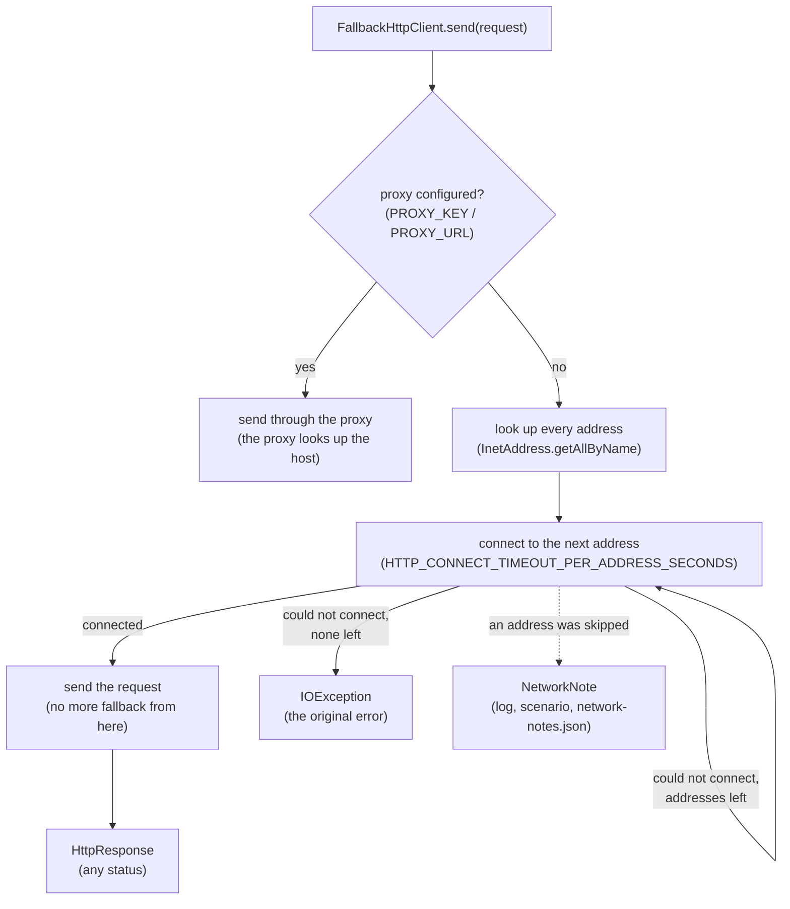

# Address fallback and network notes

A host name often resolves to several IP addresses (Slack, GitHub, cloud APIs and CDNs rotate through many). When a
firewall, route or proxy rule blocks only some of them, a client that tries just the first address fails some of the
time and works the rest: the classic "intermittent connect timed out". teswiz's own outgoing calls avoid that by
trying each address of the host in turn, and they record a **network note** whenever an address had to be skipped, so
the blocked address is visible instead of hidden behind a retry.

Works the same on macOS, Windows, Linux and every CI runner: it uses the JVM's own name lookup
(`InetAddress.getAllByName`), so it honours the hosts file, the system resolver and IPv4/IPv6 preferences.

## What it does

For each request:

1. Look up every address of the host.
2. Try the first one with a short connect timeout (`HTTP_CONNECT_TIMEOUT_PER_ADDRESS_SECONDS`, 5 by default).
3. If it cannot be connected to, try the next one. Each address is tried **once**.
4. Fall back **only before anything is sent**. Once the request has started to be sent, any failure ends the call, so
   a request (for example a POST) is never sent twice.
5. Whenever an address was skipped, record one network note.



With `HTTP_ADDRESS_FALLBACK=false`, only the first address is tried.

```
WARN NetworkNotes - Network note: hooks.slack.com:443 (slack): 54.0.0.1 unreachable
     (SocketTimeoutException: connect timed out) -> connected via 54.0.0.2
WARN NetworkNotes - Network note: wallet.example:443 (api): all 2 address(es) unreachable:
     10.0.0.1 (ConnectException: Connection refused), 10.0.0.2 (ConnectException: Connection refused)
```

Notes never change a result: a call that connected via another address succeeds; a call where every address failed
fails with the original error, exactly as before.

## Settings

| Key | Meaning | Default |
|---|---|---|
| `HTTP_ADDRESS_FALLBACK` | Try a host's other addresses when one cannot be reached. Only `false` turns it off. | `true` |
| `HTTP_CONNECT_TIMEOUT_PER_ADDRESS_SECONDS` | How long each address gets to connect (whole seconds, > 0). | `5` |

Like every teswiz setting: set it in the config file, or override it with an environment variable or system property
of the same name. With `HTTP_ADDRESS_FALLBACK=false` only the first address is tried, with the call's own timeout.

When a proxy is configured (`PROXY_KEY` / `PROXY_URL`), the proxy looks up the host, so there is nothing to fall back
between; the call goes through the proxy as before.

## Where notes show up

| Where | What |
|---|---|
| Log | One `Network note:` warning per note, as it happens. |
| Scenario | A note recorded while a scenario runs goes to that scenario's ReportPortal log, and into its `TestExecutionContext` under `TEST_CONTEXT.NETWORK_NOTES` (a `List<String>`), where an `@After` hook can attach it to the Cucumber report. |
| End of run | A per-host summary warning (only when there are notes), and `network-notes.json` in the reports directory (always written, `[]` when empty), for a pipeline summary to aggregate. |

```
WARN RunNetworkNotes - Network notes for this run: 1 host(s) needed address fallback
  hooks.slack.com:443  fallbacks=2  unreachable=[54.0.0.1]  used=[54.0.0.2]
```

A note recorded after the run's reports are written (for example by the end-of-run Slack notification itself) is in
the log only.

## Which connections use it

| Connection | Address fallback | Network notes |
|---|---|---|
| Slack notification (`SlackSender`) | yes — `FallbackHttpClient` | yes |
| API heartbeat (`HeartBeat`) | yes — `FallbackHttpClient` | yes |
| App download (`AppPathResolver`) | yes — `FallbackHttpClient` (HEAD via `send`, streamed GET via `download`) | yes (`app-download`) |
| `Api` (OkHttp) | yes — OkHttp tries every address natively | no |
| Playwright (browsers and `PlaywrightApiManager`) | yes — Playwright's own connection logic tries every address | no |
| REST Assured (Apache HttpClient) | yes — tries every address natively | no |
| Email notification (SMTP, `jakarta.mail`) | no — `jakarta.mail` opens the socket itself | no |
| Telemetry (`TelemetryCollector`) | no — not migrated (fire-and-forget, 2s budget) | no |

## Using it from your own code

```java
FallbackHttpClient client = new FallbackHttpClient("my-service");
HttpResponse response = client.send(HttpRequest.post(url, "application/json", body, Duration.ofSeconds(20)));
```

`send` returns any status (a 4xx or 5xx is an answer, not a failure) and throws `IOException` when no address could be
connected to or the call failed after connecting. Redirects are followed only with `.followingRedirects()`.

For a large body (for example an app file), stream it to a file instead of holding it in memory:

```java
HttpResponse response = client.download(HttpRequest.get(url, Duration.ofSeconds(15)).followingRedirects(), target);
```

`download` uses the same address fallback as `send`. The body is written to `target` only for a 2xx status, and the
returned `HttpResponse` carries the status and headers with an empty body. If the call fails part-way through the
body, the partial file is deleted. The timeout limits each connect, read and write, not the whole download, so a
large file is not cut off while data keeps arriving. `HttpRequest.head(url, timeout)` sends a HEAD.
