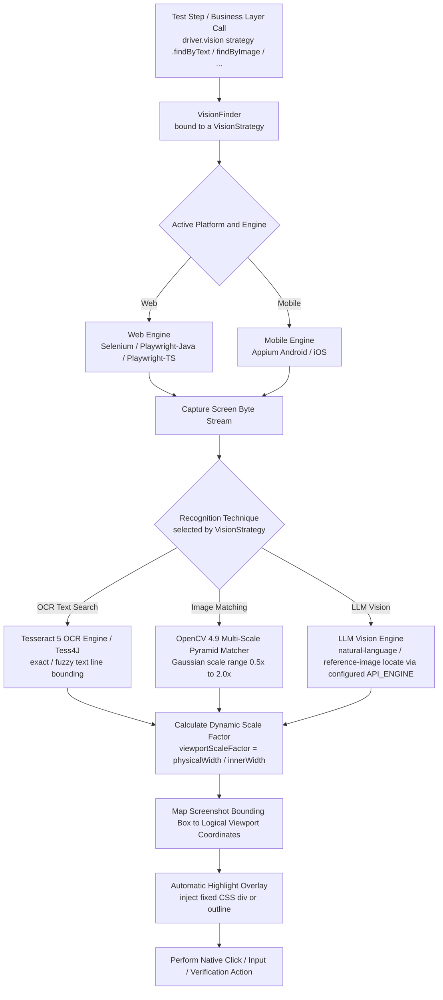
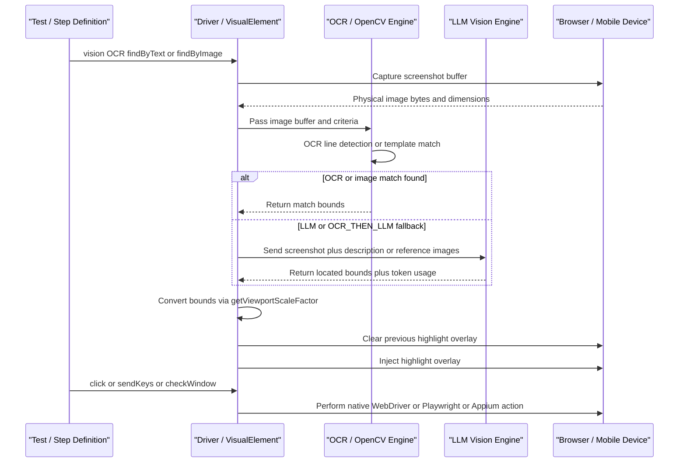

# OCR & Image Recognition Subsystem in teswiz
[📚 Documentation Index](../index.md) • [🏠 Main README](../../README.md)

---


## Table of Contents

- [Overview](#overview)
- [Architecture & Zero Core Weight Principles](#architecture--zero-core-weight-principles)
- [Subsystem Architecture & Interaction Flow](#subsystem-architecture--interaction-flow)
- [High-DPI / Retina Display Scaling & Portability](#high-dpi--retina-display-scaling--portability)
- [Technology Stack](#technology-stack)
- [Configuration Properties](#configuration-properties)
  - [Environment Variable Overrides](#environment-variable-overrides)
- [Usage Guide & API Examples](#usage-guide--api-examples)
  - [1. Locate Element by Text (`findByText`)](#1-locate-element-by-text-findbytext)
  - [2. Locate Element by Image Template (`findByImage`)](#2-locate-element-by-image-template-findbyimage)
  - [3. Fallback Strategies (`findByTextOrImage` & `findByImageOrText`)](#3-fallback-strategies-findbytextorimage--findbyimageortext)
  - [4. Extract All Visual Elements (`findAllByText` & `findAllByImage`)](#4-extract-all-visual-elements-findallbytext--findallbyimage)
  - [BDD Step Definitions for Multi-Match & Positions](#bdd-step-definitions-for-multi-match--positions)
  - [5. Wait Until an Element Becomes Visible (`waitUntilVisualElementIsVisible*`)](#5-wait-until-an-element-becomes-visible-waituntilvisualelementisvisible)
  - [6. Proximity & Spatial Relative Locators (`findRelativeByText` & `findRelativeByImage`)](#6-proximity--spatial-relative-locators-findrelativebytext--findrelativebyimage)
  - [7. Dynamic Proxy Locators (`VisualBy`)](#7-dynamic-proxy-locators-visualby)
  - [8. Reading values (`readText` / `readNumber`)](#8-reading-values-readtext--readnumber)
- [🤖 LLM Vision Locator (`VisionStrategy.LLM`)](#-llm-vision-locator-visionstrategyllm)
- [VisualElement & Web Actions with Auto-Highlighting](#visualelement--web-actions-with-auto-highlighting)
- [Exception Handling](#exception-handling)
- [Verification & Build Validation](#verification--build-validation)

---


## 🛠️ Overview

**teswiz** provides an embedded, 100% offline, free, Apache 2.0 open-source Visual OCR (Optical Character Recognition) and Multi-Scale Image Recognition subsystem. This subsystem enables automated test scripts across **Selenium (Web)**, **Playwright**, and **Appium (Android & iOS Mobile)** to locate and interact with UI elements on screen using exact/fuzzy text matching or image template matching without relying on traditional DOM or native XPaths.

All visual locators are reached through a single, explicit, strategy-scoped entry point: **`driver.vision(VisionStrategy)`**. The strategy you pass decides which engine runs:

- `VisionStrategy.OCR` — local Tesseract OCR + OpenCV image-template matching (offline, free).
- `VisionStrategy.LLM` — a vision-capable LLM locates the element from a natural-language description and/or reference images (opt-in, requires an endpoint + key; see [LLM Vision Locator](#-llm-vision-locator-visionstrategyllm)).
- `VisionStrategy.OCR_THEN_LLM` — try OCR/image first, and only if that misses, fall back to the LLM.

> **Note:** there are no longer flat `driver.findByText(...)` / `driver.findByImage(...)` methods. Every locator call now goes through `driver.vision(strategy).<method>(...)`. The method names are the same across strategies; the strategy decides the engine. For `LLM`, the `text` argument is a natural-language description and image paths are reference/example images.

---

## 🏗️ Architecture & Zero Core Weight Principles

1. **Zero Core Footprint**: `teswiz` core JAR declares `opencv`, `tess4j`, and `onnxruntime` as `compileOnly` dependencies. Downstream projects using `teswiz` carry **0 MB additional weight** by default.
2. **On-Demand Enablement**: When `IS_OCR_ENABLED=true` is set in configuration properties or environment variables, visual recognition capability is activated, and runtime dependencies are downloaded on demand if needed.
3. **Graceful Subsystem Protection**: When `IS_OCR_ENABLED=false` (default), invoking visual element locator methods throws a descriptive `VisualSubsystemDisabledException` explaining how to enable OCR capability in `config.properties`.
4. **Automatic Element Highlighting & Highlight Removal**: Visual/DOM interactions draw an orange-red translucent bounding box around target elements (`HIGHLIGHT_ELEMENTS=true`, default `true`). Before the next element interaction or visual check runs, previous highlights are automatically removed (`clearHighlight()`).

---

## 🏗️ Subsystem Architecture & Interaction Flow





### Class Responsibilities

The subsystem follows the Feature → Step → BL → Screen pattern, with responsibilities kept separated:

- **`VisualOcrBL`** — business layer; thin, well-traced orchestration over the screen contract (finders,
  verifications, `waitUntilVisualElementIsVisible*`, actions).
- **`VisualOcrScreen`** — the screen contract, segregated into role interfaces: `VisualElementFinder` (locate),
  `VisualElementActions` (act), and `VisualElementInspector` (inspect). It is an abstract aggregate implementing
  all three, kept abstract with a no-arg constructor so the dynamically generated `playwright-ts` bridge can
  subclass it.
- **`AbstractVisualOcrScreen`** — shared implementation of the single action choreography (find → assert →
  highlight → screenshot-before → act → wait → screenshot-after) for the convention-resolved platform screens
  (Android, iOS, web/Selenium, web/Playwright-Java). Platform classes are thin: a constructor plus an
  `afterTextEntry()` hook (mobile dismisses the keyboard).
- **`VisualElement`** — an immutable geometric value object (bounds + label). It forwards each gesture to the
  `Driver` facade with its own centre/geometry and never inspects the driver type.
- **`Driver` + `VisualGestureDispatcher`** — the facade exposes intent methods (`visualClickAt`, `visualSwipe`,
  …) and delegates to `VisualGestureDispatcher`, which owns the single place that maps a gesture onto Appium
  touch, native coordinate input, Selenium `Actions`, or synthesised DOM events.
- **`VisualElementWebElementAdapter`** — adapts a `VisualElement` to the Selenium `WebElement` API (used by
  `VisualBy` locators), kept separate from the value object.

---

## 🖥️ High-DPI / Retina Display Scaling & Portability

The visual subsystem handles screen resolutions, High-DPI displays (macOS Retina 2x/3x, Windows 125%/150%/200% scale factor), and headless browser modes (`HEADLESS=true`):

- **Dynamic Scale Factor**: `driver.getViewportScaleFactor(screenshotImageWidth)` calculates `scaleFactor = screenshotImageWidth / window.innerWidth` at runtime.
- **Logical CSS Viewport Bounding**: OCR physical screenshot bounds `(x, y, w, h)` are dynamically divided by `scaleFactor` to produce logical CSS viewport coordinates.
- **Universal Portability**: Highlight overlay `<div>` elements use CSS `position: fixed` and `pointer-events: none`, guaranteeing 100% accurate visual alignment across macOS, Windows, Linux, headed browsers, and headless CI execution.

---

## 🧰 Technology Stack

- **Tess4J 5 (Tesseract 5 OCR)**: Offline optical character recognition engine for detecting text regions and extracting exact line bounding boxes on screen capture byte streams.
- **OpenCV 4.9 (Multi-Scale Image Pyramid Matching)**: OpenCV template matching using multi-scale Gaussian pyramids (`0.5x` to `2.0x` scaling) to match target image templates regardless of device screen resolution or DPI scaling.
- **ONNX Runtime (optional / experimental)**: `onnxruntime` is a declared `compileOnly` dependency reserved for a future neural-OCR engine (e.g. PaddleOCR); there is no PaddleOCR code wired into the active OCR path today. The shipping OCR engine is Tess4J (Tesseract 5).
- **LLM Vision (opt-in)**: when `VisionStrategy.LLM` / `VisionStrategy.OCR_THEN_LLM` is used, a vision-capable LLM locates the element from a natural-language description and/or reference images. Disabled by default; see [LLM Vision Locator](#-llm-vision-locator-visionstrategyllm).

---

## 🎛️ Configuration Properties

Configure visual parameters in canonical template `configs/teswiz/teswiz_config.properties.template` or your project execution `.properties` file:

```properties
# Enable/Disable Visual OCR & Image Recognition capability (default false)
IS_OCR_ENABLED=false

# Visual match confidence threshold (0.0 to 1.0, default 0.85)
VISUAL_CONFIDENCE_THRESHOLD=0.85

# Number of attempts and per-attempt delay (seconds) used when polling for a visual element -
# e.g. count/at-least verifications and waitUntilVisualElementIsVisible* (defaults: 3 attempts, 1 second).
VISUAL_ELEMENT_RETRY_ATTEMPTS=3
VISUAL_ELEMENT_RETRY_DELAY_SECONDS=1

# Configurable post-action settle delay in seconds after visual clicks/inputs (default 1)
VISUAL_ACTION_WAIT_SECONDS=1

# Enable/Disable interactive element highlighting (default true)
HIGHLIGHT_ELEMENTS=true
```

> The default maximum wait for `waitUntilVisualElementIsVisible*` (when no explicit timeout is passed) is derived
> from `VISUAL_ELEMENT_RETRY_ATTEMPTS x VISUAL_ELEMENT_RETRY_DELAY_SECONDS`, and the inter-poll sleep is
> `VISUAL_ELEMENT_RETRY_DELAY_SECONDS`.

### LLM Vision Configuration (optional)

The LLM vision locator (`VisionStrategy.LLM` and the LLM tier of `OCR_THEN_LLM`) is opt-in and disabled by
default. When enabled, teswiz validates the configuration at startup (structural checks plus, for providers that
expose a non-billable `/models`-style listing, a lightweight authorization health-check) and fails fast on
misconfiguration. The API key is read from an **environment variable** (never stored in a properties file), so it
works cleanly in CI.

```properties
# Master switch for the LLM vision locator (default false)
#LLM_VISION_FALLBACK_ENABLED=false

# Provider: openai | azure-openai | anthropic | gemini | vertex-gemini | groq | xai | openrouter |
#           ollama | bedrock | custom
#LLM_VISION_PROVIDER=openai

# Model id. Optional for openai/azure-openai/anthropic/gemini/vertex-gemini (defaults apply, e.g.
# gpt-4o for openai); MANDATORY for groq, xai, openrouter, ollama, and bedrock (fails fast if blank).
#LLM_VISION_MODEL=

# Mandatory when enabled: the vision chat-completions endpoint
#LLM_VISION_ENDPOINT=<llm-vision-endpoint>

# Name of the ENV VAR that holds the API key (never the key itself).
# Not required for vertex-gemini, which uses Google Application Default Credentials.
#LLM_VISION_API_KEY_ENV=LLM_VISION_API_KEY

# Azure OpenAI api-version (only used by azure-openai)
#LLM_VISION_API_VERSION=2024-06-01

# Optional startup health-check override. Blank = teswiz auto-derives the provider's non-billable
# models-listing URL; an explicit http(s) URL is probed verbatim (reusing the provider's auth
# headers); 'none' (or 'off'/'false') skips the live probe and does structural checks only.
#LLM_VISION_HEALTH_CHECK_URL=

# Network-level retries per LLM call (default 1)
#LLM_VISION_MAX_RETRIES=1

# Per-call network timeout in seconds (default 30)
#LLM_VISION_TIMEOUT_SECONDS=30

# Write a masked per-call request/response file under the scenario's
# llm-vision-traffic/ report folder (default true)
#LLM_VISION_LOG_API_TRAFFIC=true
```

> **OCR and LLM are independent.** You may enable the LLM locator with OCR disabled (`IS_OCR_ENABLED=false`,
> `LLM_VISION_FALLBACK_ENABLED=true`) if a screen uses only `VisionStrategy.LLM`. `VisionStrategy.OCR_THEN_LLM`
> requires both, since its first tier is OCR.

### Environment Variable Overrides
System properties or environment variables take precedence over configuration files:
- `IS_OCR_ENABLED=true`
- `VISUAL_CONFIDENCE_THRESHOLD=0.90`
- `VISUAL_ELEMENT_RETRY_ATTEMPTS=5`
- `VISUAL_ELEMENT_RETRY_DELAY_SECONDS=2`
- `VISUAL_ACTION_WAIT_SECONDS=2`
- `HIGHLIGHT_ELEMENTS=true`

---

## 💡 Usage Guide & API Examples

> All locator calls go through the strategy-scoped entry point `driver.vision(VisionStrategy.OCR)`. Add the
> import once in your screen implementation:
>
> ```java
> import com.znsio.teswiz.entities.VisionStrategy;
> ```

### 1. Locate Element by Text (`findByText`)

Find an on-screen element using OCR text extraction (via `vision(OCR)`):

```java
// Find element by exact or contained text string
VisualElement loginButton = driver.vision(VisionStrategy.OCR).findByText("Login");
loginButton.click();
```

### 2. Locate Element by Image Template (`findByImage`)

Find an on-screen element using multi-scale image matching (via `vision(OCR)`):

```java
// Match single template image
VisualElement profileIcon = driver.vision(VisionStrategy.OCR)
    .findByImage(List.of("src/test/resources/images/profile_icon.png"));
profileIcon.click();

// Match best candidate across multiple template variations with custom confidence
VisualElement checkoutBtn = driver.vision(VisionStrategy.OCR).findByImage(
    List.of("src/test/resources/images/checkout_v1.png", "src/test/resources/images/checkout_v2.png"),
    0.85
);
checkoutBtn.click();
```

### 3. Fallback Strategies (`findByTextOrImage` & `findByImageOrText`)

Use resilient multi-modal fallback strategies when elements may render text or icons depending on dynamic themes or screen sizes (via `vision(OCR)`):

```java
// Try OCR text matching first; fallback to image template if text is not found
VisualElement submitBtn = driver.vision(VisionStrategy.OCR)
    .findByTextOrImage("Submit", List.of("src/test/resources/images/submit_icon.png"));
submitBtn.click();

// Try image matching first; fallback to OCR text if icon is missing
VisualElement cartBtn = driver.vision(VisionStrategy.OCR)
    .findByImageOrText(List.of("src/test/resources/images/cart_icon.png"), "Cart");
cartBtn.click();
```

### 4. Extract All Visual Elements (`findAllByText` & `findAllByImage`)

Retrieve all matching elements on screen as a `List<VisualElement>` with Non-Maximum Suppression (NMS) duplicate filtering (via `vision(OCR)`):

```java
// Retrieve all elements matching OCR text "Details"
List<VisualElement> detailButtons = driver.vision(VisionStrategy.OCR).findAllByText("Details");
for (VisualElement item : detailButtons) {
    item.highlight();
}

// Click the 2nd matching visual element
driver.vision(VisionStrategy.OCR).findAllByText("Details").get(1).click();
```

### BDD Step Definitions for Multi-Match & Positions

```gherkin
# Find and highlight all instances on screen (with visual checkpoint)
And I visually find all instances of "a station solid green dot on the map" using image template "src/test/resources/images/solid_green_dot.png"
And I visually find all instances of "Station" using OCR text "Station"
And I visually inspect all instances of "Metro logo" using image template "src/test/resources/images/metro.png"

# Multi-instance fallback matching (OCR text primary; fallback to image template)
And I visually find all instances of "Submit button" using fallback OCR text "Submit" or image template "src/test/resources/images/submit.png"
And I visually find all instances of "Cart icon" using fallback image template "src/test/resources/images/cart.png" or OCR text "Cart"


# Click by ordinal position / alias ("first", "last", "1st", "2nd", "3rd", "4th", etc.)
When I visually click the "first" element matching OCR text "Details"
When I visually click the "last" element matching OCR text "Details"
When I visually click the "2nd" element matching OCR text "Details"

# Click by zero-based integer index
When I visually click element at index 0 matching OCR text "Details"

# Verify exact match count
Then I verify 3 visual elements are present using OCR text "Details"
Then I verify 5 visual elements are present using image template "src/test/resources/images/dot.png"

# Verify minimum match count
Then I verify at least 2 visual elements are present using OCR text "Details"
Then I verify at least 1 visual elements are present using image template "src/test/resources/images/dot.png"
```


### 5. Wait Until an Element Becomes Visible (`waitUntilVisualElementIsVisible*`)

For dynamic screens where an element appears after a delay (animations, async loads), poll until the element is
located on screen or a maximum wait budget elapses. A visual element is reported as *visible* when the OCR/image
matcher locates it on the current screen capture - there is no separate visibility flag. These methods work across
every engine (Selenium, Playwright-Java, Playwright-TS, Appium) because they poll the same engine-agnostic
locators used elsewhere.

Each locator variant has two overloads: one that defaults the maximum wait from configuration, and one that takes
an explicit maximum wait in seconds. If the element does not appear within the budget, the test fails with a
descriptive assertion.

```java
VisualOcrBL visual = new VisualOcrBL();

// By OCR text - default wait budget (VISUAL_ELEMENT_RETRY_ATTEMPTS x VISUAL_ELEMENT_RETRY_DELAY_SECONDS)
VisualElement banner = visual.waitUntilVisualElementIsVisibleByText("Order Confirmed");

// By OCR text - explicit maximum wait of 15 seconds
visual.waitUntilVisualElementIsVisibleByText("Order Confirmed", 15);

// By image template (default / explicit timeout)
visual.waitUntilVisualElementIsVisibleByImage("src/test/resources/images/spinner_done.png");
visual.waitUntilVisualElementIsVisibleByImage("src/test/resources/images/spinner_done.png", 20);

// Fallback: OCR text first, then image template (or the reverse)
visual.waitUntilVisualElementIsVisibleByTextOrImage("Continue", "src/test/resources/images/continue.png", 10);
visual.waitUntilVisualElementIsVisibleByImageOrText("src/test/resources/images/continue.png", "Continue", 10);
```

#### BDD Step Definitions for Wait Until Visible

```gherkin
# Default wait budget (from configuration)
When I wait until visual element is visible using OCR text "Order Confirmed"
When I wait until visual element is visible using image template "src/test/resources/images/spinner_done.png"
When I wait until visual element is visible using fallback OCR text "Continue" or image template "src/test/resources/images/continue.png"
When I wait until visual element is visible using fallback image template "src/test/resources/images/continue.png" or OCR text "Continue"

# Explicit maximum wait in seconds
When I wait until visual element is visible using OCR text "Order Confirmed" within 15 seconds
When I wait until visual element is visible using image template "src/test/resources/images/spinner_done.png" within 20 seconds
When I wait until visual element is visible using fallback OCR text "Continue" or image template "src/test/resources/images/continue.png" within 10 seconds
When I wait until visual element is visible using fallback image template "src/test/resources/images/continue.png" or OCR text "Continue" within 10 seconds
```


### 6. Proximity & Spatial Relative Locators (`findRelativeByText` & `findRelativeByImage`)

Locate targets relative to an anchor text/image on screen (`ABOVE`, `BELOW`, `LEFT_OF`, `RIGHT_OF`, `NEAR`).
Relative/spatial finds run on OCR, so use `vision(VisionStrategy.OCR)` (or `OCR_THEN_LLM`); they are not
supported under `VisionStrategy.LLM`:

```java
// Find text "Submit" located to the RIGHT_OF anchor text "Cancel"
VisualElement submitBtn = driver.vision(VisionStrategy.OCR)
    .findRelativeByText("Submit", SpatialDirection.RIGHT_OF, "Cancel");
submitBtn.click();

// Find element "Total" BELOW anchor text "Subtotal"
VisualElement totalAmount = driver.vision(VisionStrategy.OCR)
    .findRelativeByText("Total", SpatialDirection.BELOW, "Subtotal");
```

### 7. Dynamic Proxy Locators (`VisualBy`)

Use `VisualBy` locators seamlessly with standard `Driver.findElement` / `Driver.findElements` calls:

```java
// Dynamic OCR text locator proxy
WebElement loginBtn = driver.findElement(VisualBy.ocr("Login"));
loginBtn.click();

// Dynamic template image locator proxy
WebElement logo = driver.findElement(VisualBy.image("src/test/resources/images/logo.png", 0.90));
```

### 8. Reading values (`readText` / `readNumber`)

The `findBy*` methods **locate** an element matching a value you already know ("find where 'SPIN' is"). The
read methods do the opposite - they **read the unknown value** in a screen region ("what number is in the
balance box?") and return it. They are reached through the same strategy-scoped entry point as the finders.

#### The region parameter

Every read takes a `VisualRegion` - the rectangle to read. Obtain one either explicitly from coordinates or by
deriving it from an anchor you already located:

```java
import com.znsio.teswiz.entities.VisualRegion;

// Explicit pixel rectangle (x, y, width, height) in logical viewport coordinates
VisualRegion balanceBox = VisualRegion.inRegion(1180, 60, 160, 40);

// Derived from an anchor element/region you located first (e.g. via findByText)
VisualElement anchor = driver.vision(VisionStrategy.OCR).findByText("Balance");
VisualRegion nextToAnchor = VisualRegion.from(anchor);   // same bounds as the anchor
```

#### `readText` / `readValue`

```java
import com.znsio.teswiz.entities.VisionStrategy;
import com.znsio.teswiz.entities.VisualRegion;

VisualRegion region = VisualRegion.inRegion(1180, 60, 160, 40);

// OCR read (deterministic, offline) - returns whatever text is recognised ("" when nothing is read)
String balanceText = driver.vision(VisionStrategy.OCR).readText(region);

// LLM / OCR_THEN_LLM arms need a description of WHAT to read - use readValue(region, description)
String jackpot = driver.vision(VisionStrategy.OCR_THEN_LLM)
    .readValue(region, "the jackpot amount in the top-right panel");
```

Under pure `VisionStrategy.OCR` the description is ignored, so `readText(region)` is the natural call; under
`LLM` and `OCR_THEN_LLM` the LLM arm needs the description, so prefer `readValue(region, description)`.

#### `OcrReadHint` - tuning the hard cases

Small fonts, single values, and digits-only fields read more reliably with a hint. `OcrReadHint` carries three
knobs - a page-segmentation mode (how the region is laid out), an upscale factor (the crop is magnified before
OCR, default ~3x), and an optional character whitelist (restrict recognition to a known alphabet). Create one via
a static factory and optionally tweak it with the fluent `with*` copies:

```java
import com.znsio.teswiz.visual.OcrReadHint;

// Defaults: single text block, ~3x upscale, no whitelist
String label = driver.vision(VisionStrategy.OCR).readText(region, OcrReadHint.defaults());

// digits(): single line + numeric whitelist "0123456789.,"  - best for amounts/counters
String amount = driver.vision(VisionStrategy.OCR).readText(region, OcrReadHint.digits());

// Tune further: single-line layout, 4x upscale, letters-only whitelist
OcrReadHint custom = OcrReadHint.singleLine()
    .withUpscaleFactor(4.0)
    .withCharacterWhitelist("ABCDEFGHIJKLMNOPQRSTUVWXYZ");
String code = driver.vision(VisionStrategy.OCR).readText(region, custom);
```

#### `readNumber`

`readNumber` reads a numeric value and returns an `Optional<BigDecimal>` - `Optional.empty()` when the region is
blank or the read is not numeric (it never throws). It uses a numeric-friendly hint and is locale-tolerant of the
common `1,234.56` grouping, stripping currency symbols/whitespace and thousands separators before parsing:

```java
import java.math.BigDecimal;
import java.util.Optional;

Optional<BigDecimal> balance = driver.vision(VisionStrategy.OCR).readNumber(region);
balance.ifPresent(value -> LOGGER.info("Balance is {}", value));

// LLM / OCR_THEN_LLM: pass a description for the LLM arm
Optional<BigDecimal> win = driver.vision(VisionStrategy.OCR_THEN_LLM)
    .readNumber(region, "the win amount");
```

#### Strategy behaviour

The read methods route on the strategy exactly like the finders:

| Strategy | `readText` / `readValue` | `readNumber` |
|---|---|---|
| `OCR` | OCR read (deterministic default); description ignored | OCR read, then numeric-parse |
| `LLM` | LLM reads the value for the description | LLM reads, then numeric-parse |
| `OCR_THEN_LLM` | OCR read first; fall back to the LLM read **only when the OCR result is blank** | OCR number first; fall back to the LLM read+parse **only when the OCR result is empty/unparseable** |

#### BDD step definitions

```gherkin
# OCR read of a region (deterministic default)
When I read the text in region 1180 60 160 40 using OCR
When I read the number in region 1180 60 160 40 using OCR

# Strategy-routed read with a description for the LLM/OCR_THEN_LLM arms
When I read "the jackpot amount" in region 1180 60 160 40 using "OCR_THEN_LLM"
```

---

## 🤖 LLM Vision Locator (`VisionStrategy.LLM`)

Beyond local OCR and OpenCV image matching, teswiz can locate an on-screen element with a **vision-capable
LLM**. Instead of exact text or a pixel template, you describe the element in natural language and/or supply one
or more reference/example images, and the model returns the element's bounding box. This is useful when a target
is hard to pin down with OCR or a fixed template - themed/branded icons, loosely-worded labels, or
"the primary call-to-action" style descriptions.

It is **opt-in and disabled by default** (`LLM_VISION_FALLBACK_ENABLED=false`). The LLM path is implemented, but
runtime verification against a live endpoint is still **pending** - treat it as ready to wire up rather than
field-proven, and do not rely on any particular accuracy/latency numbers.

### When to use which strategy

The same finder methods are exposed on every strategy; the strategy decides which engine runs:

- **`VisionStrategy.OCR`** - local Tesseract OCR + OpenCV image matching only (offline, free, default).
- **`VisionStrategy.LLM`** - the LLM locates the element directly from your description and/or reference images.
  No OCR/OpenCV is attempted.
- **`VisionStrategy.OCR_THEN_LLM`** - try OCR/image first and, only if that misses, fall back to the LLM. Requires
  both OCR and the LLM to be enabled.

> Relative/spatial finds (`findRelativeByText` / `findRelativeByImage`) and the image-first/`*OrText`
> multi-match variants run on OCR only and are not supported under `VisionStrategy.LLM`.

### Java examples

```java
import com.znsio.teswiz.entities.VisionStrategy;

// Describe the element in natural language and let the LLM locate it
VisualElement loginButton = driver.vision(VisionStrategy.LLM).findByText("the blue Login button");
loginButton.click();

// Locate from one or more reference/example images
VisualElement cartIcon = driver.vision(VisionStrategy.LLM)
    .findByImage(List.of("src/test/resources/images/ref1.png", "src/test/resources/images/ref2.png"));

// Try OCR first, fall back to the LLM only if OCR misses
VisualElement submit = driver.vision(VisionStrategy.OCR_THEN_LLM).findByText("Login");
submit.click();
```

### Configuration & providers

All LLM vision keys (master switch, provider, model, endpoint, API-key env var, retries, timeout, traffic
logging) are documented in the [LLM Vision Configuration](#llm-vision-configuration-optional) block above - this
section does not duplicate the full table.

Supported providers (`LLM_VISION_PROVIDER`): **`openai`**, **`azure-openai`**, **`anthropic`**, **`gemini`**,
**`vertex-gemini`**, **`groq`**, **`xai`** (Grok vision), **`openrouter`**, **`ollama`**, **`bedrock`** (AWS
Bedrock Runtime `Converse` API, authenticated with a Bedrock API key as a Bearer token), and **`custom`** (any
OpenAI-compatible chat-completions endpoint). `groq`, `xai`, `openrouter`, and `ollama` speak the
OpenAI-compatible wire format. The API key is read from an environment variable named by `LLM_VISION_API_KEY_ENV`
(never stored in a properties file); `vertex-gemini` uses Google Application Default Credentials and `ollama`
(local server) needs no key. `LLM_VISION_MODEL` is mandatory for `groq`, `xai`, `openrouter`, `ollama`, and
`bedrock` - no default model is assumed, so a blank model fails fast at startup.

The LLM HTTP calls reuse the configured **`API_ENGINE`**, so they share teswiz's existing HTTP stack, retry, and
masking behavior rather than introducing a separate client.

> **OCR-off + LLM-on is valid.** If a screen uses only `VisionStrategy.LLM`, you may run with
> `IS_OCR_ENABLED=false` and `LLM_VISION_FALLBACK_ENABLED=true`. `OCR_THEN_LLM` needs both, since its first tier
> is OCR.

### Token usage, summaries & telemetry

Each LLM vision request logs its token usage: number of calls, prompt/completion/total tokens, and total duration
in seconds. These are accumulated **per test** and committed to a run-level registry so the end of a run prints a
**per-test breakdown plus run totals**. The run-completed telemetry event includes an aggregate LLM-usage block
containing numeric totals and the provider enum only - no prompts, screenshots, descriptions, or keys.

### Traffic logging & secret redaction

When `LLM_VISION_LOG_API_TRAFFIC=true` (default), each call writes a masked request/response file into a dedicated
**`llm-vision-traffic/`** sub-folder of the current scenario's report directory. It is kept separate from the
test's own `api-traffic/` folder so LLM calls are not confused with application API calls. Sensitive values
(including the API key and endpoint credentials) are redacted before anything is written.

### Fail-fast startup validation

When `LLM_VISION_FALLBACK_ENABLED=true`, teswiz validates the LLM vision configuration **at startup** and fails
fast on misconfiguration (for example, a blank or malformed `LLM_VISION_ENDPOINT`, a missing API-key environment
variable, or a blank `LLM_VISION_MODEL` for a provider that requires one). Each provider also exposes an optional
**non-billable** authorization probe that the validator runs when available: a `/models`-style listing for
`openai`, `azure-openai`, `gemini`, `vertex-gemini`, `groq`, `xai`, `openrouter`, `ollama`, and `custom`, so a
broken endpoint or key is reported before any test runs rather than mid-suite. `anthropic` and `bedrock` have no
non-billable listing endpoint, so they are validated **structurally only** (no health-check call is made, by
design, to avoid incurring billable inference at startup).

The derived probe URL is a best-effort guess at each provider's models-listing path. When teswiz cannot derive
the correct path for your provider or endpoint (the symptom is a startup failure with an HTTP 404 against a
`/models`-style URL even though your key and endpoint are valid), set **`LLM_VISION_HEALTH_CHECK_URL`** to the
exact non-billable listing URL and teswiz probes that verbatim (reusing the provider's auth headers). Set it to
**`none`** (or `off`/`false`) to skip the live probe entirely and fall back to structural validation only. Leave
it blank to keep the auto-derived default.

### Harvesting LLM matches into your image library

LLM calls cost money and add latency, so you do not want to call the LLM every run for the same element. When
`LLM_VISION_SAVE_CAPTURES=true` (default), every successful LLM locate **crops the located element from the
screenshot and saves it as a reusable OpenCV template PNG** under a dedicated `llm-vision-captures/` sub-folder of
the current scenario's report directory. The crop is taken from the raw screenshot at the raw pixel bounding box,
so it is directly usable as an image template.

Each capture is reported in two places:

- **Console** - an explicit message naming the saved file plus a *suggested* image-template file name and location
  (a placeholder path such as `<your-image-template-dir>/submit-button.png`, with `src/test/resources/images/...`
  shown only as an example). The name is a suggestion, not a rule - rename and place it wherever your project
  keeps templates.
- **Run summary** - a "New LLM vision captures" section listing every saved file and its suggested name, plus a
  per-test and total count.

The intended lifecycle is **human-in-the-loop**, not automatic caching:

1. Run with `VisionStrategy.LLM` (or `OCR_THEN_LLM`). The LLM locates the element and a crop is harvested.
2. Review the saved crop. If it cleanly bounds the element, copy it into your own image-template directory under a
   name you choose.
3. Switch that locator to `driver.vision(VisionStrategy.OCR_THEN_LLM).findByImage(List.of("<your-dir>/your-name.png"))`.
   Now OpenCV matches the promoted template locally on future runs and the LLM is only called if the local match
   fails.

teswiz never auto-reuses a capture: a slightly-off crop promoted blindly would cause silent flakiness, so
promotion is always your explicit, reviewed step. Set `LLM_VISION_SAVE_CAPTURES=false` to skip saving crops.

---

## VisualElement & Web Actions with Auto-Highlighting


When `HIGHLIGHT_ELEMENTS=true` (default), standard interaction methods across Selenium, Playwright-Java, Playwright-TS, and Appium automatically clear existing highlights, apply orange-red outlines, and dispatch native actions:

```java
VisualElement element = driver.vision(VisionStrategy.OCR).findByText("Settings");

element.click();                       // Left-click / Mobile Tap at center
element.doubleClick();                 // Double-click / Mobile Double Tap
element.hover();                       // Mouse hover over center
element.sendKeys("Search query");       // Focus & type text
element.tap();                         // Mobile tap
element.doubleTap();                   // Mobile double tap
element.longPress();                   // Long-press (default 2s) / longPress(Duration)
element.swipe(Direction.UP);           // W3C gesture swipe UP on element
element.dragAndDropTo(targetElement); // Drag element center to target element
```

Each visual element gesture is dispatched through the real input pipeline for the active engine. A
`VisualElement` is a pure geometric value object: it forwards each gesture to the `Driver` facade with its own
centre/geometry, and the facade's `VisualGestureDispatcher` chooses the mechanism. The dispatch order is Appium
touch → browser native coordinate input (used by Playwright, so gestures also reach `<canvas>` content) →
Selenium `Actions` → synthesised DOM events as a last resort.

If a driver supports none of these mechanisms for a requested gesture, a `UnsupportedVisualGestureException` is
thrown rather than silently doing nothing — a skipped gesture would otherwise let a test pass against an
application that never reacted.

**Engine parity for gestures:**

| Gesture | Selenium | Playwright-Java | Playwright-TS | Appium |
|---|---|---|---|---|
| click, doubleClick, hover, sendKeys | ✅ | ✅ | ✅ | ✅ |
| swipe, longPress | native input only¹ | ✅ | ✅ | ✅ |
| zoom, pinch | ❌ (not implemented on any engine) | ❌ | ❌ | ❌ |

¹ `swipe` and `longPress` need touch (Appium) or native coordinate input (Playwright). On a **plain Selenium web
driver** that exposes neither, they are genuinely unsupported and throw `UnsupportedVisualGestureException` —
**parity is not required here**, because a mouse-only web driver has no touch gesture to perform. `zoom`/`pinch`
are not implemented on any engine today and always throw.

### Before / After Screenshots on Visual Actions

Every visual OCR action performed through the screen layer (click, double-click, hover, long-press, swipe, enter
text, position/index/relative clicks, and the `tryClick*` variants) captures a **before** screenshot, performs the
action, waits `VISUAL_ACTION_WAIT_SECONDS`, then captures an **after** screenshot. This makes the effect of each
visual interaction traceable in the run artifacts. Inspection methods (`inspect*`) capture a single screenshot and
perform no action.

---

## Exception Handling

If an OCR/image locator (`driver.vision(VisionStrategy.OCR)...`) is invoked when `IS_OCR_ENABLED=false`,
`VisualSubsystemDisabledException` is thrown:

```
com.znsio.teswiz.exceptions.VisualSubsystemDisabledException:
[teswiz] Visual OCR & Image Recognition Subsystem is Disabled!
To enable visual text/image locators (driver.vision(VisionStrategy.OCR)...), set 'IS_OCR_ENABLED=true' in your execution config.properties file or system properties.
```

> **Note:** invoking an LLM locator (`driver.vision(VisionStrategy.LLM)...`, or the LLM tier of
> `OCR_THEN_LLM`) while the LLM vision fallback is disabled throws a similar `VisualSubsystemDisabledException`
> whose message reads *"[teswiz] LLM Vision Fallback is Disabled!"* and explains how to set
> `LLM_VISION_FALLBACK_ENABLED=true` plus the endpoint/key. See
> [LLM Vision Locator](#-llm-vision-locator-visionstrategyllm).

If an element cannot be matched visually above `VISUAL_CONFIDENCE_THRESHOLD`:

```
com.znsio.teswiz.exceptions.NoSuchVisualElementException:
[teswiz] Unable to locate visual element by text/image template matching on screen. Target: 'Login', Threshold: 0.85
```

If a gesture is requested on an engine that provides no mechanism to perform it (e.g. a swipe or long-press on a
plain Selenium web driver with no touch and no native coordinate input), `UnsupportedVisualGestureException` is
thrown instead of silently skipping the gesture:

```
com.znsio.teswiz.exceptions.UnsupportedVisualGestureException:
Cannot perform 'swipe' on visual element 'map tile': the active driver supports no touch, native coordinate input,
Selenium Actions, or JavascriptExecutor mechanism for this gesture
```

---

## Verification & Build Validation

Verify template synchronization and build integrity:

```bash
./gradlew validateConfigurationTemplates
./gradlew test --tests "com.znsio.teswiz.visual.VisualSubsystemTest"
```
