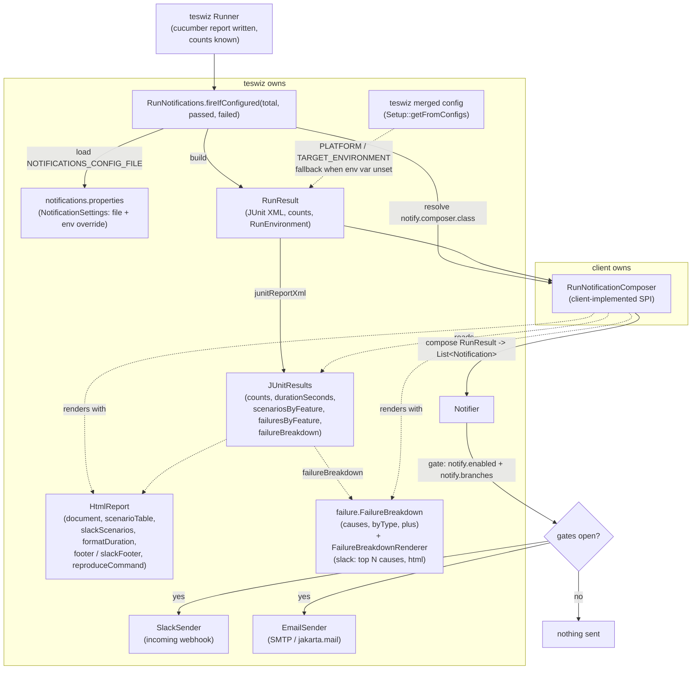

# 🔔 End-of-run Notifications (Slack + Email)
[📚 Documentation Index](../index.md) • [🏠 Main README](../../README.md)

---

teswiz can send a notification at the **end of a run** — to Slack, email, or both — summarising the result and
where it ran. The whole runtime (trigger, gating, delivery, channels) lives in teswiz under
`com.znsio.teswiz.reporting.notify`. A consuming project supplies only the **message content** by implementing a
small composer interface; it never wires a Gradle task or an after-suite hook.

The feature is **entirely opt-in and OFF by default**:

- If the `NOTIFICATIONS_CONFIG_FILE` config key is unset, teswiz does nothing.
- If `notify.composer.class` is blank, teswiz does nothing.
- If `notify.enabled` is `false` (the default), nothing is delivered.

A notifier problem is **logged and swallowed** by default — it never changes a run's pass/fail result (opt in to
fail-fast with `notify.fail.on.error`, see below).

---

## 🧩 How it fits together



**teswiz owns** the trigger, settings loading, gating, the two channels, and the content helpers (`JUnitResults`,
`HtmlReport`, the `failure` breakdown) a composer can use. **The client owns** what each message says and which destinations it targets. teswiz
never branches on what a message *means*.

---

## ⚙️ Configuration

Notification settings are **separate** from the teswiz execution config, in their own `notifications.properties` file
with lower-case dotted keys. teswiz finds that file through the **`NOTIFICATIONS_CONFIG_FILE`** key in your
`config.properties` — exactly how teswiz resolves its other external config files (`ENVIRONMENT_CONFIG_FILE`,
`TEST_DATA_FILE`, the Applitools config). Leave `NOTIFICATIONS_CONFIG_FILE` unset to disable notifications entirely;
there is no magic classpath fallback.

```properties
# in config.properties
NOTIFICATIONS_CONFIG_FILE=./configs/teswiz/notifications.properties
```

A ready-made, **disabled** `configs/teswiz/notifications.properties` ships in the repo and is the path every example
`config.properties` points at, so the sample runs are a complete no-op out of the box. Use it as your starting point,
or copy the fully-commented canonical template and turn on only what you need:

```
configs/teswiz/notifications.properties.template  ->  <your notifications.properties>
```

The file may live anywhere on disk (it is loaded by path, not from the classpath). Placing it under `configs/` is
fine — the execution-config validator deliberately ignores `*notifications.properties` because it is not a teswiz
execution config.

| Key | Purpose | Default |
| :--- | :--- | :--- |
| `notify.enabled` | Master switch | `false` |
| `notify.fail.on.error` | Fail the run when it wanted to notify but could not (see below) | `false` |
| `notify.composer.class` | Fully-qualified `RunNotificationComposer` implementation (public no-arg ctor) | *(blank = off)* |
| `notify.branches` | Comma-separated branch allowlist; trailing-`*` glob supported | `master` |
| `notify.slack.enabled` | Convenience toggle your composer may read | `false` |
| `notify.email.enabled` | Convenience toggle your composer may read | `false` |
| `notify.smtp.host` | SMTP server host | *(blank)* |
| `notify.smtp.port` | SMTP server port | *(blank)* |
| `notify.smtp.tls` | Use STARTTLS | *(blank)* |
| `notify.smtp.auth` | Authenticate to the relay | *(blank)* |
| `notify.smtp.from` | From address | *(blank)* |
| `notify.smtp.username` | SMTP username | *(blank)* |

### Environment overrides

Every key can be overridden by an environment variable named by upper-snake-casing the key and replacing dots with
underscores — and the env value always wins. So a project ships safe (off) defaults in the file and CI flips only the
switches it needs:

| Key | Env variable |
| :--- | :--- |
| `notify.enabled` | `NOTIFY_ENABLED` |
| `notify.smtp.host` | `NOTIFY_SMTP_HOST` |

### Secrets (environment only)

Secrets are **never** read from the file:

| Secret | Source | Used by |
| :--- | :--- | :--- |
| `SMTP_PASSWORD` | environment variable | Email channel |
| Slack incoming-webhook URL | resolved by your composer (by convention from an env var) | Slack channel |

A Slack incoming-webhook URL already targets one channel and **is** the secret, so it is never logged.

---

## 🏷️ Run provenance (CI-provider agnostic)

Every notification carries a **run-context footer** so a recipient can trace a result back to where it ran. teswiz
detects the CI provider from its signature environment variable and reads that provider's native variables — it is
**not** GitLab-specific. Supported providers:

| Provider | Detected by | Example fields mapped |
| :--- | :--- | :--- |
| GitLab | `CI_PIPELINE_ID` | `CI_PIPELINE_URL`, `CI_JOB_NAME`, `CI_COMMIT_SHORT_SHA`, `GITLAB_USER_NAME` |
| GitHub Actions | `GITHUB_ACTIONS` | `GITHUB_RUN_ID`, `GITHUB_JOB`, `GITHUB_SHA`, `GITHUB_ACTOR` |
| Jenkins | `JENKINS_URL` | `BUILD_NUMBER`, `JOB_NAME`, `BUILD_URL`, `GIT_COMMIT`, `NODE_NAME` |
| CircleCI | `CIRCLECI` | `CIRCLE_WORKFLOW_ID`, `CIRCLE_JOB`, `CIRCLE_SHA1`, `CIRCLE_USERNAME` |
| Bitbucket Pipelines | `BITBUCKET_BUILD_NUMBER` | `BITBUCKET_PIPELINE_UUID`, `BITBUCKET_COMMIT` |
| Azure Pipelines | `TF_BUILD` | `BUILD_BUILDID`, `AGENT_JOBNAME`, `BUILD_SOURCEVERSION`, `BUILD_REQUESTEDFOR` |
| Local | *(none match)* | host + logged-in user |

An unrecognised environment resolves as a **local** run (host + user). The branch is resolved once by teswiz (the CI
ref, else `BRANCH_NAME` from config, else `git rev-parse`) and reused here.

`RunEnvironment` also carries the **platform** (`PLATFORM`) and **target environment** (`TARGET_ENVIRONMENT`) — handy
for a composer that wants a `[PLATFORM][ENV]` subject prefix. These prefer the process environment but **fall back to
teswiz's already-resolved configuration** (`Setup.getFromConfigs`) when the environment has no value: on a local run
they typically live in `config.properties`, not the shell, so reading only `System.getenv` would leave them blank.
A CI run that exports them still takes the exported value. Either is an empty string when neither source has it.

The configuration fallback is an **injected lookup**, not a read of global state:
`RunEnvironment.resolve(env, branch, hostSupplier, userSupplier, configLookup)` takes it as its last argument, and
`RunNotifications` passes `Setup::getFromConfigs`. The 4-argument `resolve(...)` overload uses no fallback (platform and
environment come from the map only), which keeps resolution deterministic and unit-testable offline.

---

## ✍️ Implementing a composer

```java
package com.yourproject.notify;

import java.util.List;
import com.znsio.teswiz.reporting.notify.Notification;
import com.znsio.teswiz.reporting.notify.RunNotificationComposer;
import com.znsio.teswiz.reporting.notify.RunResult;

public class RunNotificationComposerImpl implements RunNotificationComposer {

    @Override
    public List<Notification> compose(RunResult result) {
        // Return an empty list to send nothing for this run.
        String subject = (result.hasFailures() ? "FAILED" : "PASSED")
                + " — " + result.passedScenarios() + "/" + result.totalScenarios() + " passed";
        String slackText = subject;      // add detail / HtmlReport.withSlackSeparator(...) as needed
        String htmlBody = subject;       // or build with HtmlReport.document(...)
        String slackWebhookUrl = System.getenv("SLACK_WEBHOOK_URL"); // the secret — never commit it
        List<String> emailRecipients = List.of("team@example.com");

        return List.of(new Notification("run", subject, slackText, htmlBody, slackWebhookUrl, emailRecipients));
    }
}
```

Then, in `notifications.properties`:

```properties
notify.enabled=true
notify.composer.class=com.yourproject.notify.RunNotificationComposerImpl
notify.branches=master,main
```

---

## 🧱 Report content helpers

`JUnitResults` and `HtmlReport` (same package) are optional building blocks for richer messages. teswiz only parses
and renders; what goes into a message stays your composer's decision.

### `JUnitResults` — parse the run's JUnit XML

Load it with `JUnitResults.fromXml(result.junitReportXml())`. The path is `null` when no report was written, so check
`JUnitResults.isReadable(path)` first.

| Method | Returns |
| :--- | :--- |
| `totalTests()`, `passed()`, `failed()`, `errors()`, `skipped()` | Scenario counts |
| `hasFailures()`, `isEmpty()` | Convenience flags |
| `durationSeconds()` | Total run duration from the suite's `time` attribute (`0` when absent) |
| `scenariosByFeature()` | **Every** scenario grouped by feature, in document order. Each `Scenario` has `name`, `status` (`ScenarioStatus`: passed, failed, errored, skipped), `reason` (the `message` attribute), `time`, `type` (the fully-qualified exception class from the `type` attribute) and `trace` (the stack trace in the element body). `type` and `trace` are `""` when absent |
| `failuresByFeature()` | Failing scenario names per feature. Derived from the same list as `scenariosByFeature()` |
| `failureBreakdown()` | The failed and errored scenarios counted by cause — see [Failure breakdown](#failure-breakdown--why-did-things-fail) |

`reason` alone rarely names the exception: an uncaught exception's message is just its text (`Index 0 out of bounds
for length 0`), and an XML parser turns the line breaks inside the attribute into spaces. Use `type` for what kind of
failure it was and `trace` for where it came from.

### Failure breakdown — "why did things fail?"

`com.znsio.teswiz.reporting.notify.failure` turns failing scenarios into causes. A cause is the simple exception class
name, the place it came from, and the Gherkin step it failed on:
- **type + place** — the place is the first stack frame of the code under test, with JDK and well-known library frames
  skipped. For an AssertJ soft-assertion wrapper (`AssertJMultipleFailuresError`, thrown from the after-scenario hook),
  the place is the assertion's own origin line from the message instead.
- **step** — the Gherkin step running when the scenario failed, read from the `[step N: ...]` marker a soft-assertion
  message carries, or from the Cucumber `at ✽.<step>(file:...feature:n)` pseudo-frame in an ordinary failure's trace.
  When neither carries it, the step is blank and the cause degrades to grouping by type and place alone (backward
  compatible).

Scenarios failing on the same line **and the same step** are one cause, so eight failures from one bug read as one
line. One code location reached by several different steps splits into one cause per step, each with its own count — a
shared balance assertion hit by "reduced", "increased" and "restored" is three causes, not one.

| Type | Use |
| :--- | :--- |
| `FailureBreakdown` | `JUnitResults.failureBreakdown()` or `FailureBreakdown.of(scenariosByFeature)`. `causes()` is the per-cause count, biggest first; `byType()` merges places; `total()` always equals `failed() + errors()` (an unclassifiable failure is counted as `Unclassified`, never dropped); `plus(other)` merges several runs |
| `FailureClassifier` | `classify(scenario)` → `FailureCause(type, location, step)` for one failed scenario |
| `FailureBreakdownRenderer` | `slack(breakdown)` / `slack(breakdown, maxCauses)` / `slack(breakdown, maxCauses, label)` (top `DEFAULT_MAX_CAUSES` = 10 cause groups) and `html(breakdown)` / `html(breakdown, label)`; all return `""` for an empty breakdown. `label` is a `Function<String,String>` from the simple exception class name to a friendly label; the overloads without it use `SIMPLE_TYPE` (the class name unchanged) |

**Friendly label.** A consumer passes a `label` function to name its own exceptions for the reader
(`PoolExhaustedException` → "No test user available"); unmapped types fall back to their simple class name. The raw
class name is always shown next to the place, so an engineer still has the exact type to search for.

Rendered for Slack: a bold heading with the failure and cause counts, then the top cause groups in a code block so
Slack shows it monospaced. Each group is a two-line header — `×count` and the friendly label, then the place with the
raw class name beside it — followed by one nested `└ step  ×count` row per failing step. Splitting the place and class
onto their own line keeps each line short so a narrow Slack client does not wrap and misalign the block.

~~~~text
*Why did things fail?*  10 failures · 2 causes
```
×7  No test user available
    SessionBL.leaseUser:88 (PoolExhaustedException)
    └ Given the player is authenticated  ×7
×3  Assertion failed (multiple checks)
    BalanceTracking.assertDelta:182 (AssertJMultipleFailuresError)
    └ Then the balance is reduced by 1.0    ×2
    └ Then the balance is increased by 5.0  ×1
```
~~~~

If there are more cause groups than `maxCauses`, one line after the code block counts the rest, e.g.
`_+4 more causes in the full report_`. The wording is singular for one (`1 failure · 1 cause`, `+1 more cause`). Slack
markup in a label, place or step is neutralised: `&`, `<` and `>` become their HTML entities (`&amp;`, `&lt;`, `&gt;`)
and a backtick is printed as `'`. Slack reads `&`, `<` and `>` as markup even inside a code block, so without this a
constructor-frame place like `Widget.<init>:7` would have its `<init>` read as a mention and dropped. The entities each
render as a single glyph, so the rendered table looks unchanged and the columns stay aligned (escaping happens after
the fixed-width padding).

The HTML block is a four-column table (`Failure` = the friendly label, `Where` = the place with the raw class beside
it, `Failing step`, `Count`) grouped the same way: a group header row carries the label, the place and the `×count`
subtotal, and each failing step is a nested row with its own `×count`. A `Total failed` row ends the table with a plain
number.

> **Upgrading from 1.0.52:** `FailureCause` gained a third component, `step`, so `new FailureCause(type, location)` is
> still valid (step defaults to blank) but `causes()` keys may now differ when a location is reached by several steps.
> The Slack and HTML output changed shape (grouped, two-line Slack header, four-column HTML, `×N` counts, friendly
> label). If your composer or its tests match the old flat text, update them; pass a `label` function to name your own
> exceptions. The no-label overloads keep working with the class name as the label.

### `HtmlReport` — render it

| Method | Purpose |
| :--- | :--- |
| `document(title, failed, body, footer)` | Self-contained HTML card with a pass/fail status banner |
| `scenarioTable(scenariosByFeature)` | Email breakdown: one status-pill table (status, scenario, time) per feature; a failed scenario shows its reason |
| `slackScenarios(scenariosByFeature, showTime)` | Slack breakdown: bold feature name, then one blockquoted line per scenario (✅ pass, 🔴 fail, ⚪ skip) |
| `formatDuration(seconds)` | `42.5s` under a minute, `3m 05s` above it, `—` for a non-positive value |
| `footer(env, reproduceCommand)` / `slackFooter(env, reproduceCommand)` | Run-context footer (CI trace or host + user) for email and Slack |
| `links(labelToUrl, env)` | Drill-down links, shown on CI runs only |
| `reproduceCommand(orderedInputs)` | Builds a shell-safe `K=V ... ./gradlew run` string |
| `withSlackSeparator(text)`, `escape(raw)` | Slack separator line and HTML escaping |

### The reproduce command is yours to compose

teswiz has no notion of which run inputs identify a run (region, market, brand, tag, and so on), so
`RunEnvironment` carries **no** reproduce command. Your composer picks the inputs, in the order it wants, and passes
the result to the footers:

```java
Map<String, String> inputs = new LinkedHashMap<>();   // insertion order is the output order
inputs.put("TARGET_ENVIRONMENT", result.runEnvironment().environment());
inputs.put("TAG", "@smoke and not @wip");              // spaces are fine; see quoting below

String command = HtmlReport.reproduceCommand(inputs);
// TARGET_ENVIRONMENT=prod TAG='@smoke and not @wip' ./gradlew run

String htmlFooter = HtmlReport.footer(result.runEnvironment(), command);
String slackFooter = HtmlReport.slackFooter(result.runEnvironment(), command);
```

Quoting is POSIX-shell safe: a value is left bare when it has no shell metacharacters and single-quoted otherwise
(an embedded `'` becomes `'\''`). This matters for Cucumber tags such as `@a and (@b or @c)`, which would otherwise
break when pasted into zsh. Blank values are skipped; an empty map yields just `./gradlew run`. Pass a blank command
to `footer(...)` / `slackFooter(...)` to omit the "Reproduce" line.

> **Upgrading from 1.0.46:** `footer(env)` and `slackFooter(env)` became `footer(env, reproduceCommand)` and
> `slackFooter(env, reproduceCommand)`, and `RunEnvironment.reproduceCommand()` was removed. Build the command with
> `HtmlReport.reproduceCommand(...)` and pass it in.

---

## ✅ Delivery guarantees & fail-fast

By default (`notify.fail.on.error=false`) notifications are **best-effort** and never affect the run:

- A missing destination (blank webhook / empty recipients) for an enabled channel is reported as
  `SKIPPED_NO_DESTINATION`.
- Any transport failure, non-2xx response, SMTP timeout, or malformed webhook URL is swallowed to `FAILED` and logged.
- A broken composer (not found / not a `RunNotificationComposer` / no public no-arg constructor) is logged and skipped.
- Nothing escapes the after-run hook — the run's exit status is untouched.

### Opt-in fail-fast (`notify.fail.on.error=true`)

Set this when a missing notification is itself a failure you want to catch (for example, a nightly run that *must*
post to Slack). With it enabled, a run that **wanted to notify but could not** fails fast with a
`NotificationException`:

| Situation | `fail.on.error=false` (default) | `fail.on.error=true` |
| :--- | :--- | :--- |
| Delivered successfully | run unaffected | run unaffected |
| Enabled channel, no/blank destination | logged, run unaffected | **run fails** |
| Invalid webhook / SMTP error / timeout | logged, run unaffected | **run fails** |
| Broken composer class | logged, run unaffected | **run fails** |
| Nothing configured / `notify.enabled=false` | no-op | no-op |

This is the answer to "what if `notify.slack.enabled=true` but `SLACK_WEBHOOK_URL` is unset or invalid?": by default
it is logged and the run is unaffected; with `notify.fail.on.error=true` the run fails fast with a clear message
naming the channel that could not be delivered.

The rationale for the default being off: a transient Slack/SMTP blip should not flip a green test run to red. Turn it
on when you would rather be told loudly that your notification setup is broken.
