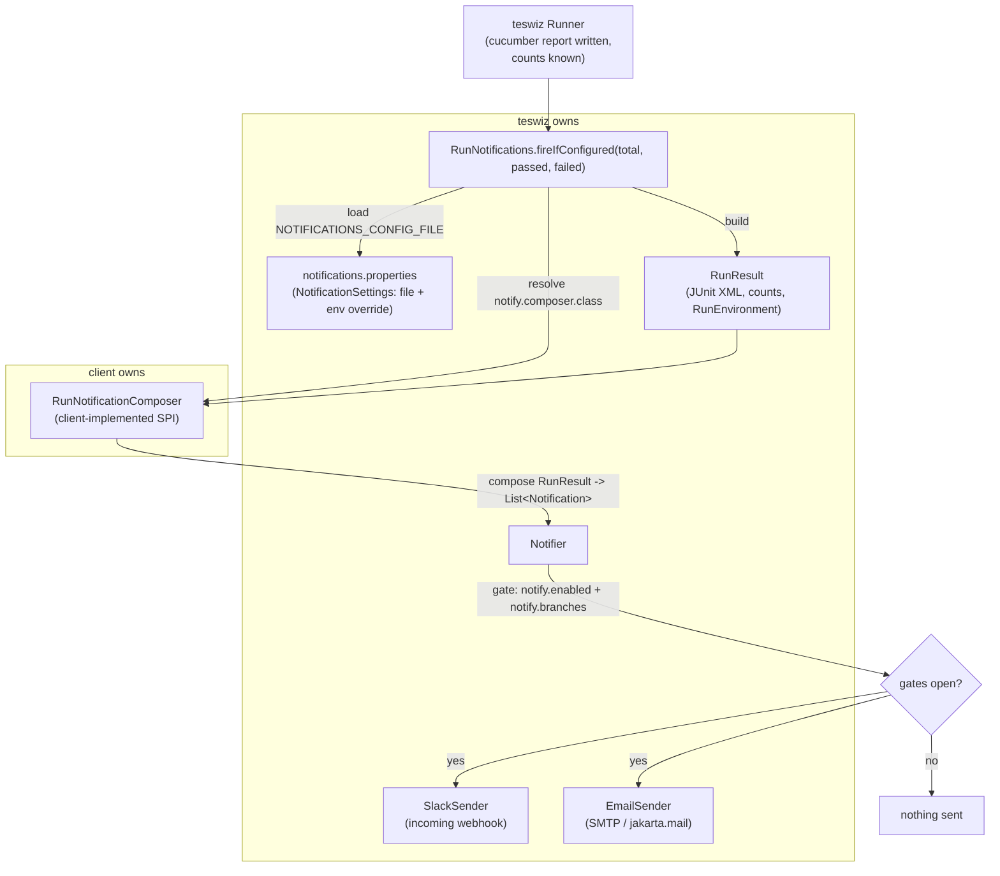

# 🔔 End-of-run Notifications (Slack + Email)
[📚 Documentation Index](../index.md) • [🏠 Main README](../../README.md)

---

teswiz can send a notification at the **end of a run** — to Slack, email, or both — summarising the result and
where it ran. The whole runtime (trigger, gating, delivery, channels) lives in teswiz under
`com.znsio.teswiz.reporting.notify`. A consuming project supplies only the **message content** by implementing a
small composer interface; it never wires a Gradle task or an after-suite hook.

The feature is **entirely opt-in and OFF by default**:

- If the `NOTIFICATIONS_CONFIG_FILE` config key is unset, teswiz does nothing.
- If `notify.composer.class` is blank, teswiz does nothing.
- If `notify.enabled` is `false` (the default), nothing is delivered.

A notifier problem is **logged and swallowed** by default — it never changes a run's pass/fail result (opt in to
fail-fast with `notify.fail.on.error`, see below).

---

## 🧩 How it fits together



**teswiz owns** the trigger, settings loading, gating, and the two channels. **The client owns** what each message
says and which destinations it targets. teswiz never branches on what a message *means*.

---

## ⚙️ Configuration

Notification settings are **separate** from the teswiz execution config, in their own `notifications.properties` file
with lower-case dotted keys. teswiz finds that file through the **`NOTIFICATIONS_CONFIG_FILE`** key in your
`config.properties` — exactly how teswiz resolves its other external config files (`ENVIRONMENT_CONFIG_FILE`,
`TEST_DATA_FILE`, the Applitools config). Leave `NOTIFICATIONS_CONFIG_FILE` unset to disable notifications entirely;
there is no magic classpath fallback.

```properties
# in config.properties
NOTIFICATIONS_CONFIG_FILE=./configs/teswiz/notifications.properties
```

A ready-made, **disabled** `configs/teswiz/notifications.properties` ships in the repo and is the path every example
`config.properties` points at, so the sample runs are a complete no-op out of the box. Use it as your starting point,
or copy the fully-commented canonical template and turn on only what you need:

```
configs/teswiz/notifications.properties.template  ->  <your notifications.properties>
```

The file may live anywhere on disk (it is loaded by path, not from the classpath). Placing it under `configs/` is
fine — the execution-config validator deliberately ignores `*notifications.properties` because it is not a teswiz
execution config.

| Key | Purpose | Default |
| :--- | :--- | :--- |
| `notify.enabled` | Master switch | `false` |
| `notify.fail.on.error` | Fail the run when it wanted to notify but could not (see below) | `false` |
| `notify.composer.class` | Fully-qualified `RunNotificationComposer` implementation (public no-arg ctor) | *(blank = off)* |
| `notify.branches` | Comma-separated branch allowlist; trailing-`*` glob supported | `master` |
| `notify.slack.enabled` | Convenience toggle your composer may read | `false` |
| `notify.email.enabled` | Convenience toggle your composer may read | `false` |
| `notify.smtp.host` | SMTP server host | *(blank)* |
| `notify.smtp.port` | SMTP server port | *(blank)* |
| `notify.smtp.tls` | Use STARTTLS | *(blank)* |
| `notify.smtp.auth` | Authenticate to the relay | *(blank)* |
| `notify.smtp.from` | From address | *(blank)* |
| `notify.smtp.username` | SMTP username | *(blank)* |

### Environment overrides

Every key can be overridden by an environment variable named by upper-snake-casing the key and replacing dots with
underscores — and the env value always wins. So a project ships safe (off) defaults in the file and CI flips only the
switches it needs:

| Key | Env variable |
| :--- | :--- |
| `notify.enabled` | `NOTIFY_ENABLED` |
| `notify.smtp.host` | `NOTIFY_SMTP_HOST` |

### Secrets (environment only)

Secrets are **never** read from the file:

| Secret | Source | Used by |
| :--- | :--- | :--- |
| `SMTP_PASSWORD` | environment variable | Email channel |
| Slack incoming-webhook URL | resolved by your composer (by convention from an env var) | Slack channel |

A Slack incoming-webhook URL already targets one channel and **is** the secret, so it is never logged.

---

## 🏷️ Run provenance (CI-provider agnostic)

Every notification carries a **run-context footer** so a recipient can trace a result back to where it ran. teswiz
detects the CI provider from its signature environment variable and reads that provider's native variables — it is
**not** GitLab-specific. Supported providers:

| Provider | Detected by | Example fields mapped |
| :--- | :--- | :--- |
| GitLab | `CI_PIPELINE_ID` | `CI_PIPELINE_URL`, `CI_JOB_NAME`, `CI_COMMIT_SHORT_SHA`, `GITLAB_USER_NAME` |
| GitHub Actions | `GITHUB_ACTIONS` | `GITHUB_RUN_ID`, `GITHUB_JOB`, `GITHUB_SHA`, `GITHUB_ACTOR` |
| Jenkins | `JENKINS_URL` | `BUILD_NUMBER`, `JOB_NAME`, `BUILD_URL`, `GIT_COMMIT`, `NODE_NAME` |
| CircleCI | `CIRCLECI` | `CIRCLE_WORKFLOW_ID`, `CIRCLE_JOB`, `CIRCLE_SHA1`, `CIRCLE_USERNAME` |
| Bitbucket Pipelines | `BITBUCKET_BUILD_NUMBER` | `BITBUCKET_PIPELINE_UUID`, `BITBUCKET_COMMIT` |
| Azure Pipelines | `TF_BUILD` | `BUILD_BUILDID`, `AGENT_JOBNAME`, `BUILD_SOURCEVERSION`, `BUILD_REQUESTEDFOR` |
| Local | *(none match)* | host + logged-in user |

An unrecognised environment resolves as a **local** run (host + user). The branch is resolved once by teswiz (the CI
ref, else `BRANCH_NAME` from config, else `git rev-parse`) and reused here.

---

## ✍️ Implementing a composer

```java
package com.yourproject.notify;

import java.util.List;
import com.znsio.teswiz.reporting.notify.Notification;
import com.znsio.teswiz.reporting.notify.RunNotificationComposer;
import com.znsio.teswiz.reporting.notify.RunResult;

public class RunNotificationComposerImpl implements RunNotificationComposer {

    @Override
    public List<Notification> compose(RunResult result) {
        // Return an empty list to send nothing for this run.
        String subject = (result.hasFailures() ? "FAILED" : "PASSED")
                + " — " + result.passedScenarios() + "/" + result.totalScenarios() + " passed";
        String slackText = subject;      // add detail / HtmlReport.withSlackSeparator(...) as needed
        String htmlBody = subject;       // or build with HtmlReport.document(...)
        String slackWebhookUrl = System.getenv("SLACK_WEBHOOK_URL"); // the secret — never commit it
        List<String> emailRecipients = List.of("team@example.com");

        return List.of(new Notification("run", subject, slackText, htmlBody, slackWebhookUrl, emailRecipients));
    }
}
```

Then, in `notifications.properties`:

```properties
notify.enabled=true
notify.composer.class=com.yourproject.notify.RunNotificationComposerImpl
notify.branches=master,main
```

The `HtmlReport` and `JUnitResults` helpers in the same package build a self-contained HTML card, a Slack footer,
and failures-by-feature counts from the run's JUnit XML if you want richer content.

---

## ✅ Delivery guarantees & fail-fast

By default (`notify.fail.on.error=false`) notifications are **best-effort** and never affect the run:

- A missing destination (blank webhook / empty recipients) for an enabled channel is reported as
  `SKIPPED_NO_DESTINATION`.
- Any transport failure, non-2xx response, SMTP timeout, or malformed webhook URL is swallowed to `FAILED` and logged.
- A broken composer (not found / not a `RunNotificationComposer` / no public no-arg constructor) is logged and skipped.
- Nothing escapes the after-run hook — the run's exit status is untouched.

### Opt-in fail-fast (`notify.fail.on.error=true`)

Set this when a missing notification is itself a failure you want to catch (for example, a nightly run that *must*
post to Slack). With it enabled, a run that **wanted to notify but could not** fails fast with a
`NotificationException`:

| Situation | `fail.on.error=false` (default) | `fail.on.error=true` |
| :--- | :--- | :--- |
| Delivered successfully | run unaffected | run unaffected |
| Enabled channel, no/blank destination | logged, run unaffected | **run fails** |
| Invalid webhook / SMTP error / timeout | logged, run unaffected | **run fails** |
| Broken composer class | logged, run unaffected | **run fails** |
| Nothing configured / `notify.enabled=false` | no-op | no-op |

This is the answer to "what if `notify.slack.enabled=true` but `SLACK_WEBHOOK_URL` is unset or invalid?": by default
it is logged and the run is unaffected; with `notify.fail.on.error=true` the run fails fast with a clear message
naming the channel that could not be delivered.

The rationale for the default being off: a transient Slack/SMTP blip should not flip a green test run to red. Turn it
on when you would rather be told loudly that your notification setup is broken.
